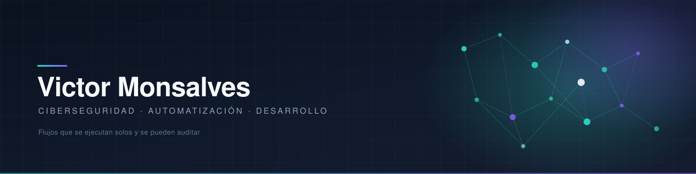

  

<h1 align="center">Victor Monsalves</h1>

  <strong>Victor Monsalves</strong> 
  Seguridad · Automatización · Herramientas

  <a href="#enfoque">Enfoque</a> ·
  <a href="#ahora">Ahora</a> ·
  <a href="#stack">Stack</a> ·
  <a href="#proyectos">Proyectos</a> ·
  <a href="#principios">Principios</a> ·
  <a href="#contacto">Contacto</a>

---

## Enfoque

Convierto procesos manuales y repetitivos en flujos que **se ejecutan solos, se pueden
auditar y fallan de forma controlada**. Menos tiempo operativo, menos error humano y
más rastro de lo que pasó.

| Área | Qué hago |
|:--|:--|
| **Automatización de operaciones** | Flujos en n8n que integran APIs, bases de datos y LLM: ingesta, normalización, decisión y publicación con deduplicación persistente. |
| **Tooling de seguridad** | Utilidades para analizar artefactos, revisar configuraciones y detectar credenciales expuestas antes de que lleguen a un repositorio. |
| **IA aplicada** | Modelos con salida estructurada, guardarraíles y revisión humana justo en el punto crítico. |

## Ahora

- Reconstruyendo el portafolio: cada proyecto se publica con README, diagrama de
  arquitectura y guía de despliegue.
- Automatización de ingesta y publicación de noticias con n8n y Groq.
- Endureciendo la cadena de trabajo: hooks anti-secretos, plantillas de proyecto y
  publicación con comprobaciones previas.

## Stack

  
  
  
  
  
  
  

## Proyectos

Trabajo principalmente en repositorios privados: contienen configuraciones de entornos
reales. El diseño y los flujos se comparten bajo petición.

| Proyecto | Qué resuelve | Stack | Acceso |
|:--|:--|:--|:--|
| **MISP multi-feed ingester** | Ingesta de IOCs multi-feed a MISP | n8n · MISP | Privado |
| **OpenCTI multi-feed intelligence** | Ingesta de threat intelligence multi-feed a OpenCTI | n8n · OpenCTI | Privado |
| **Certificados → RITM** | Crea RITMs en ServiceNow antes de que venza un certificado | n8n · ServiceNow | Privado |
| **Email triage** | Clasificación y triage de correo con LLM | n8n · Groq | Privado |
| **Agente de noticias** | Ingesta de Google News, redacción con LLM y publicación en LinkedIn con deduplicación persistente | n8n · Groq · LinkedIn API | En preparación |

## Principios

- **Guardarraíles primero.** `.env` fuera del repositorio, escaneo de credenciales y
  publicación que aborta si algo no cuadra.
- **Reproducible.** Entornos declarativos, credenciales en el gestor del sistema y
  cero secretos en el código.
- **Documentado.** El README explica el *por qué*, no solo el *qué*; los diagramas se
  entienden sin abrir el editor.
- **Verificado.** Si algo no se puede probar, se dice. El build y los tests son la
  prueba, no la promesa.

## Contacto

La vía más directa es GitHub: abre un *issue* en cualquier repositorio o mencióname
en una discusión. No publico correo para evitar scraping.

---

  Perfil mantenido por Victor Monsalves · <a href="#top">Volver arriba</a>

